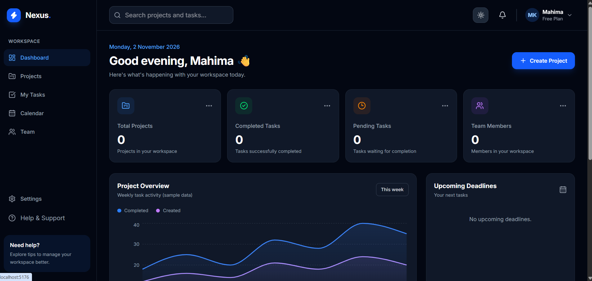
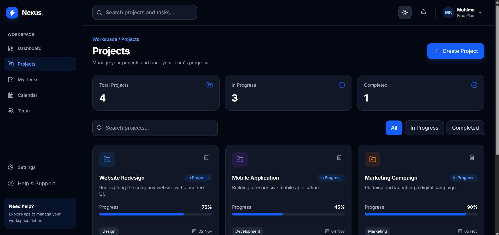
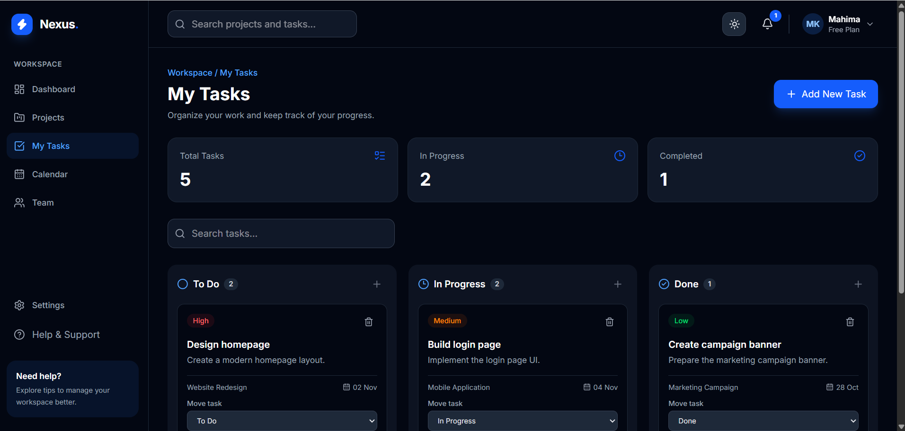
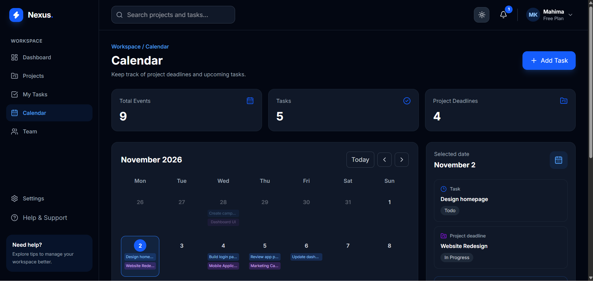

# Nexus — Project Management Dashboard

A modern, responsive project management dashboard built with React. Nexus helps users organize projects, manage tasks, track progress, and manage a workspace through a clean SaaS-style interface.

## Screenshots

### Dashboard


### Projects


### My Tasks


### Calendar


## Features

- **Dashboard:** Overview of projects, tasks, team members, and workspace activity.
- **Project Management:** Create, search, filter, and delete projects.
- **Task Management:** Create tasks, organize them by status, and update priorities and deadlines.
- **Kanban Board:** View tasks across To Do, In Progress, and Done columns.
- **Calendar:** View project and task deadlines and add tasks from the calendar.
- **Team Management:** View, invite, search, and manage demo team members.
- **Notifications:** View notifications, mark them as read, and clear them.
- **Settings:** Update profile information, workspace preferences, and notification preferences.
- **Dark and Light Mode:** Switch themes with saved preferences.
- **Responsive Design:** Designed for desktop, tablet, and mobile screens.
- **Local Data Persistence:** Save projects, tasks, team members, settings, and notifications in browser LocalStorage.

## Tech Stack

| Technology | Purpose |
|---|---|
| React 19 | Frontend UI |
| Vite 8 | Development server and build tool |
| JavaScript | Application logic |
| Tailwind CSS 4 | Styling and responsive design |
| React Router 7 | Client-side routing |
| Framer Motion | Animations and transitions |
| Lucide React | Icons |
| Recharts | Dashboard charts |
| LocalStorage | Browser-based data persistence |

## Project Structure

```text
src/
├── components/
│   ├── common/
│   │   ├── Logo.jsx
│   │   └── ThemeToggle.jsx
│   └── layout/
│       ├── Sidebar.jsx
│       ├── Header.jsx
│       └── AppLayout.jsx
├── context/
│   └── ThemeContext.jsx
├── pages/
│   ├── Dashboard.jsx
│   ├── Projects.jsx
│   ├── Tasks.jsx
│   ├── Calendar.jsx
│   ├── Team.jsx
│   └── Settings.jsx
├── App.jsx
├── index.css
└── main.jsx
```

## Getting Started

### 1. Clone the repository

```bash
git clone YOUR_GITHUB_REPOSITORY_URL
```

### 2. Open the project folder

```bash
cd Nexus
```

### 3. Install dependencies

```bash
npm install
```

### 4. Start the development server

```bash
npm run dev
```

Open the local URL shown in your terminal.

## Available Scripts

| Command | Description |
|---|---|
| `npm run dev` | Start the development server |
| `npm run build` | Create a production build |
| `npm run preview` | Preview the production build |
| `npm run lint` | Run ESLint checks |

## Data Storage and Limitations

Nexus currently uses browser LocalStorage instead of a backend database.

- Data remains available in the same browser after refreshing.
- Data is stored locally on the user's device.
- Data is not synchronized between different users or devices.
- Team invitations and notification preferences are demo functionality.
- Real email delivery, authentication, and server-side storage are not implemented.
- The dashboard chart and some activity information use sample data.

## Project Objective

Nexus demonstrates practical frontend development skills through a modern SaaS dashboard, including component-based architecture, client-side routing, responsive UI, browser storage, and interactive user experiences.

## Developer

**Mahima Kushwaha**

- GitHub: [Mahima5848](https://github.com/Mahima5848)

---

*Built as a frontend portfolio project using React and modern web technologies.*


